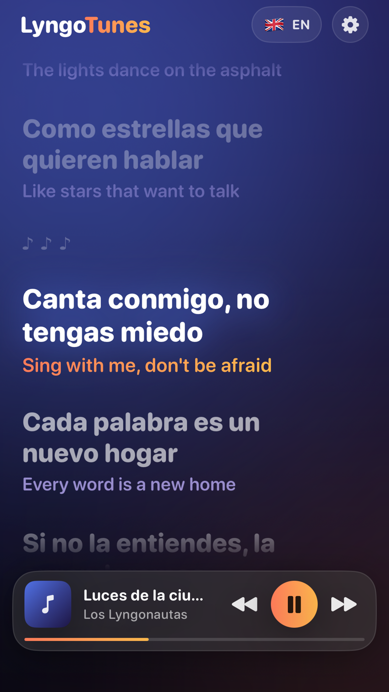
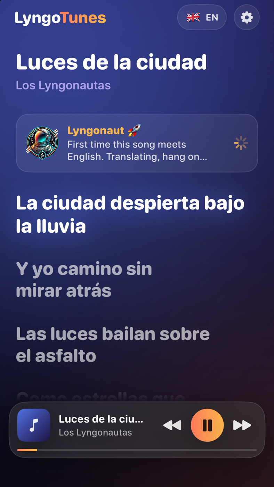
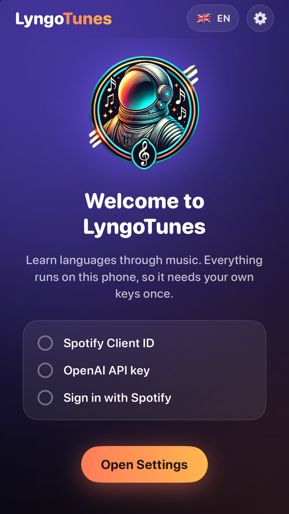

# LyngoTunes

**Learn a language through the songs you already listen to.**

LyngoTunes is a native iOS app that follows the song playing in your Spotify and shows its
lyrics line by line, each with a translation underneath. The line being sung lights up and
stays in the middle of the screen; tap any line to jump the music there.

<p align="center">
  
  
  
</p>

<sub>The songs in the screenshots are the app's built-in demo songs, written for this project.</sub>

## How it works

There is no server and no account. The app on your phone talks to three services directly,
with keys you enter once in Settings:

| What | Service | You need |
|---|---|---|
| What is playing, play / pause / seek | Spotify Web API | A Client ID from your own Spotify developer app, and Spotify Premium for the controls |
| Synced lyrics | [lrclib.net](https://lrclib.net) | Nothing |
| Translation | OpenAI API | Your own API key |

- **Spotify login without a secret.** The app uses the Authorization Code flow with PKCE,
  so only a Client ID is needed. Tokens are kept in the Keychain and refreshed silently.
- **Everything is fetched once.** Lyrics per song and translations per song and language
  are stored on the phone, so a song costs one small translation request the first time
  and nothing afterwards.
- **Lyrics first, translation second.** The lyrics appear as soon as they are found; the
  translation fills in when it is ready. Without an OpenAI key you still get the lyrics.
- **41 target languages**, switchable at any time.
- **The screen stays on** while lyrics are showing.

## Status

An early release. The app logic is covered by unit and UI tests that run against a built-in
demo player; the Spotify and OpenAI paths have had little real-world use so far. Expect
rough edges and please open an issue when you find one.

## Getting started

You need a Mac with a recent Xcode (the project was built with Xcode 27; the app targets
iOS 17 and later) and [XcodeGen](https://github.com/yonaskolb/XcodeGen).

```sh
brew install xcodegen
git clone <this repo> && cd lyngotunes
xcodegen generate
open LyngoTunes.xcodeproj
```

To run on your iPhone, copy `Config/Local.xcconfig.example` to `Config/Local.xcconfig`,
put in your Apple developer team id and a bundle id of your own, and run
`xcodegen generate` again. The Simulator needs none of that.

### Try it without any keys

In Xcode choose Product > Scheme > Edit Scheme > Run > Arguments and tick `LYNGO_DEMO`.
The app then plays two built-in songs on a pretend player: no Spotify, no network.

### Set it up for real

1. **Spotify.** Create an app at [developer.spotify.com/dashboard](https://developer.spotify.com/dashboard),
   choose Web API, and add `lyngotunes://callback` as a redirect URI. Copy its Client ID.
2. **OpenAI.** Create an API key at [platform.openai.com/api-keys](https://platform.openai.com/api-keys).
3. **In the app.** Open Settings, paste both, pick the language you want translations in,
   and tap Sign in with Spotify.
4. Play a song in Spotify and switch back to LyngoTunes.

The translation model is a setting (default `gpt-6.1-terra`). Any OpenAI chat model that
supports structured outputs works.

## Project layout

```
Packages/LyngoCore/   Pure Swift, no UI: LRC parser, Spotify auth and player calls,
                      OpenAI translator, lrclib client, local store. `swift test` runs here.
LyngoTunes/           The SwiftUI app: AppModel (state), Model/, UI/.
LyngoTunesUITests/    UI tests that drive the demo player and the Settings flow.
Tools/                Scripts: app icon renderer, contact sheets.
Config/               Bundle id and signing team (your own values stay out of git).
project.yml           XcodeGen spec; the .xcodeproj is generated.
CLAUDE.md             Notes for working on the code with an AI coding agent.
```

```sh
cd Packages/LyngoCore && swift test     # core logic
```

How to run the UI tests and drive the Simulator from the command line is in `CLAUDE.md`.

## Privacy

LyngoTunes collects nothing. Your keys and Spotify tokens are stored in the iOS Keychain
on your device. Song title and artist are sent to lrclib.net to find lyrics, and the
lyrics are sent to OpenAI with your key to be translated. Nothing else leaves the phone.

## Lyrics, copyright and trademarks

This repository contains **no song lyrics** and no API keys. The app downloads lyrics at
your request from lrclib.net, a community database; song lyrics remain the property of
their copyright holders. LyngoTunes is meant for personal language study. It is not on the
App Store, and if you distribute a build you are responsible for having the rights to do so.

Using the Spotify and OpenAI APIs is subject to their own terms, which you accept with
your own developer accounts. LyngoTunes is an independent project, not affiliated with or
endorsed by Spotify, OpenAI or lrclib.net. All trademarks belong to their owners.

## Contributing

Issues and pull requests are welcome. Please keep the core package free of UI imports,
add a test with a change, and never commit keys or lyrics.

## License

[MIT](LICENSE)
